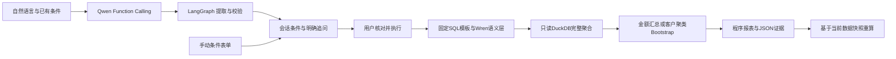

# 可核验数据分析 Agent

基于 Wren Engine 和 LangGraph 的零售分析项目。用户通过自然语言补充或修改指标、日期、发票和国家条件，确认范围后执行固定工具。金额由数据库完整聚合，统计结论由 Python 计算，报告附带口径、SQL、数据指纹和重算证据。

## Windows 快速启动

仓库：[MengyangLi11/wren-analytics-agent](https://github.com/MengyangLi11/wren-analytics-agent)。

全新下载后，在项目目录创建环境并填写本地配置：

```powershell
python -m venv .venv
Copy-Item .env.example .env
```

使用 VS Code 打开 `.env`，填写你自己的 DashScope API Key。仓库不包含密钥、原始数据、数据库或本机证据。已配置的本地项目直接保留现有环境和 `.env`。

在该目录的 VS Code PowerShell 终端执行：

```powershell
.\.venv\Scripts\python.exe -m pip install -r requirements.txt
.\.venv\Scripts\python.exe .\build_data.py
.\.venv\Scripts\python.exe -m streamlit run .\app.py
```

浏览器打开终端显示的地址，通常为 `http://localhost:8501`。首次构建会复用 `data/online_retail/raw/Online Retail.xlsx`；文件不存在时从 UCI 下载。源文件须通过固定 SHA-256 校验。读取 Excel 通常需要几十秒。

全新目录需先运行 `python -m venv .venv`，将 `.env.example` 复制为 `.env`，在本地填写 Key。已完成 API 配置的用户继续使用现有 `.env`：

```dotenv
DASHSCOPE_API_KEY=填写你本地的Key
LLM_BASE_URL=https://dashscope.aliyuncs.com/compatible-mode/v1
LLM_MODEL=qwen-plus
```

Python 使用 3.12 或 3.13。Linux/Python 3.12.14 完成工具与模拟 API 检查；Windows/Python 3.13.7 已完成真实 Qwen API 功能验收。独立克隆目录的 Windows 与 Linux 工具复现均已通过，见下方记录。`requirements.txt` 固定直接依赖；`requirements.lock.txt` 记录交付时 Linux 环境的完整依赖快照，不作为 Windows 跨平台锁文件使用。

## 两种操作入口

**自然语言**会调用本地 `.env` 配置的 Qwen API 提取条件。例如：

1. `收入多少？` → 询问指标和日期。
2. `净销售额` → 保留指标并询问日期。
3. `2011年11月` → 显示完整条件。
4. 点击“执行查询” → 数据库计算结果，保存证据。
5. `只看536365发票` → 保留指标和日期，只修改发票。
6. `取消订单筛选` → 保留指标和日期，清除发票筛选。
7. `估计2011年11月订单金额均值的置信区间` → 切换统计任务。

没有 API 时，在左侧“手动填写条件”设置范围，点击“应用条件”，核对后点击“执行查询”。该入口只验证数据和工具，不验证自然语言理解能力。

条件在当前会话内保留，页面重新加载到新会话或进程重启后不自动恢复。JSON 是分析证据，不是会话恢复文件。`/new` 清空全部条件，`/state` 查看条件，`/run` 执行；命令行入口为 `python run_chat.py`，`/quit` 退出。

## 功能与架构



LLM 不生成 SQL，不自行计算金额，不生成统计结论。SQL 模板接受经过类型校验的日期、发票与国家筛选。金额汇总在数据库处理完整匹配记录后返回一行，避免截取部分明细后由模型求和。Wren 使用 strict mode，禁用 fallback，并以只读连接执行查询。

本项目使用 Wren 的本地 SDK，不需要部署完整 WrenAI 平台。对开源组件的扩展集中在指标契约、条件状态管理、核验工具、原始行追溯、证据重算和评测。

## 数据来源与清洗口径

- 来源：Chen, D. (2015). **Online Retail**. UCI Machine Learning Repository. DOI: [10.24432/C5BW33](https://doi.org/10.24432/C5BW33)。
- 原始记录：541,909 行，2010-12-01 至 2011-12-09，单位 GBP（英镑），许可 CC BY 4.0。
- 原始 Excel SHA-256：`43465a06f2ccf7c8b5bd2892bc7defb52f97487934fe93b16ae4c3936424676d`。
- 项目规则：商品代码为五位数字及可选字母，单价大于零；普通发票的正数量纳入销售记录，C 发票的负数量纳入取消记录。该商品代码规则是分析口径，并非来源提供的完整商品分类。
- 每行先计算 `abs(Quantity) × UnitPrice`，按 ROUND_HALF_UP 保留两位小数，再汇总；不先将单价舍入到两位。
- 完全相同的原始行保留：缺少发票行业务唯一标识，不能证明它们是重复入库。缺少 CustomerID 的行仍参与金额汇总。
- 每行保留 `source_row`，对应 Excel 实际行号；排除记录及原因保存在 `raw_rows` 表。主排除原因按顺序分配，原因计数互斥，不能与原始审计中可重叠的质量标志混用。

当前规则下结果：

| 项目 | 值 |
|---|---:|
| 纳入发票行 | 536,429 |
| 非标准商品代码排除（主原因） | 2,963 |
| 非正数或无效单价排除（主原因） | 2,517 |
| 正向开票金额 | 10,271,034.61 GBP |
| 取消冲减金额 | 478,724.18 GBP |
| 净开票金额 | 9,792,310.43 GBP |

正向金额不表示已支付收款或会计收入；取消金额不等于已到账退款。C 发票号保留原值，不通过剥除 C 推断其对应原订单。税费、运费等不能凭字段缺失推定为零。项目只报告上述纳入规则覆盖的记录金额。

## 统计核验

工具估计的是：**筛选范围内，客户信息完整且一致的正向商品发票平均金额**。发票行先按 InvoiceNo 聚合；同一客户的多张发票归为一个簇。

- 缺少客户编号或同张发票客户不一致时，从区间估计样本排除并单独报告数量，金额汇总仍保留这些原始记录。
- 以客户为簇，有放回抽取客户，保留选中客户的全部发票；每次重新计算总发票金额/总发票数。估计目标是发票加权均值，而非客户均值的简单平均。
- 默认 1,000 次、95% percentile 区间、种子 42、显式 PCG64；结果记录 NumPy 版本、样本指纹、客户簇充分统计量及纳入发票。
- 少于 30 个客户簇时不输出区间。30 是工程门槛，不能保证覆盖率。
- 假设客户之间近似独立，观测客户代表拟推断的交易过程。重复客户的依赖得到簇级处理，但共同时间冲击等问题仍存在；本数据不能验证所有假设。
- 历史样本均值是确定的。Bootstrap 区间只在上述过程假设下解释，不是历史总额的计算误差，也不是因果效果或 A/B 显著性检验。

例如 2011 年 11 月纳入 2,642 张发票、1,660 个客户簇；客户信息缺失或不一致排除 109 张发票，样本均值约 432.30 GBP。区间以实际程序输出为准。

## 核验与评测

```powershell
# 自动化检查，包含真实Wren、网页表单、统计与证据改动检测；不调用真实API
.\.venv\Scripts\python.exe -m pytest -q

# 50条固定协议/工具回归，模拟模型返回参数；不代表模型准确率
.\.venv\Scripts\python.exe .\evaluate_real.py --mode offline --split all

# 真实模型先验证3条，调用已配置API，产生实际Token用量
.\.venv\Scripts\python.exe .\evaluate_real.py --mode live --split development --limit 3

# 复测指定失败用例（回归）
.\.venv\Scripts\python.exe .\evaluate_real.py --mode live --split all --ids C04 C09 C07 B01 --limit 4

# v1.0.2修复后冻结的新措辞检查集
.\.venv\Scripts\python.exe .\evaluate_real.py --suite release_check --mode live --split validation --limit 20
```

固定用例共 50 条，按开发 30/验证 20 标记，涵盖日期、国家、发票、空结果、澄清、不支持任务、样本不足及区间估计。参考金额由独立的 openpyxl + Python Decimal 路径从原始 Excel 生成，不调用被测 Wren/store。`generate_benchmark.py` 可重建参考；正常联调不应改标准答案来迎合 Agent。

2026-11-17，Windows/Python 3.13.7、`qwen-plus` 的 v1.0.2 真实 API 验收结果：

| 检查 | 通过 | 模型请求 | 总 Token | 总耗时 |
|---|---:|---:|---:|---:|
| 已知故障复测（与回归集重叠） | 4/4 | 4 | 3,532 | 6.626 秒 |
| 原有回归集 | 50/50 | 50 | 45,354 | 116.976 秒 |
| 新增措辞检查 | 20/20 | 20 | 18,180 | 47.323 秒 |

新措辞集平均每题 909 Token、2.37 秒，时间是该次串行评测的总耗时除以题数，不是并发容量或延迟分位数。

初测为开发 27/30、验证 19/20，共 46/50；四个失败在任务支持/条件提取阶段。修复后原 50 题回归达到 50/50，原用例与标准答案未改。同一 50 题总 Token 从 39,522 增至 45,354（约 +14.8%）；这是本次可靠性改进的用量代价，不等于实际账单涨幅。

原始验收 JSON 已于 2026-11-18 核对：阶段汇总与逐题记录一致，测试集与代码指纹匹配；保存的模型工具参数在固定数据/代码上回放也全部通过，回放未新增模型请求。核对范围及原件 SHA-256 见 [核对摘要](docs/evidence/acceptance_v102_verified_summary.json)。详见 [实测验收记录](docs/实测验收记录.md)。原 50 题已用于调试，新 20 题也只覆盖有限任务和措辞，不能据此宣称广泛业务准确率为 100%。

离线模式注入预设模型参数，验证的是工具、门槛与协议链路；离线通过不代表真实模型理解能力。联调中查看并针对某用例修复后，将该用例视为回归数据。真实 API 结果按上表的运行范围与证据来源解读。

本仓库聚焦已验收的 `wren_analysis` 实现。旧原型脚本在原工作目录保留，但不列入发布清单；原型 12 题成绩不与真实数据评测混用。

网页下载证据，或使用 `reports/sessions/session_*.json`，然后：

```powershell
.\.venv\Scripts\python.exe .\verify_report.py .\reports\sessions\实际文件名.json
```

重算器先确认数据与口径快照，再从类型化参数重新构建查询并计算结果；不直接执行证据中任意 SQL。数据重建后数据库二进制指纹可能变化，旧证据会因快照不一致而停止核验，应保留对应数据快照。SHA-256 用于一致性检测，并非数字签名或不可篡改存证。

## 独立目录复现

2026-11-18，从 GitHub 提交 `aa6c9ff` 重新克隆并建立独立虚拟环境：

| 环境 | 自动检查 | 离线工具回归 | 网页/数据核对 |
|---|---|---|---|
| Linux / Python 3.12.14 | 64 passed，5.62 秒 | 50/50，3.158 秒 | 原始数据重新下载、构建与金额对账通过 |
| Windows 本机 | 64 passed，7.30 秒 | 50/50，3.356 秒 | 手动查询 2011 年 11 月净开票金额 1,432,731.70 GBP |

两轮离线回归均为 0 模型调用、0 Token，不代表真实模型理解成绩。Windows 记录来自用户终端输出及截图，Linux 记录来自实际执行。详见 [独立环境复现记录](docs/独立环境复现记录.md)。

## 目录

```text
app.py                    网页入口
build_data.py             真实数据构建与金额对账
run_chat.py               真实数据命令行会话
evaluate_real.py          离线/真实API评测
verify_report.py          证据重算
wren_analysis/            数据、Wren查询、会话、口径门槛、统计工具
benchmarks/real_cases.json 固定评测与独立参考
tests/                    自动化检查与网页流程
docs/                     验收、面试讲解与交付验证记录
data/retail/               本机生成的真实数据库与清单
reports/                  本机生成的会话与评测证据
```

本地生成的数据、证据和 `.env` 均列入 `.gitignore`。`.gitattributes` 禁用自动换行转换，以保留代码与 JSON 的字节指纹。公开上传报告前检查其原始输入及机器路径。

下一步交付材料见 [GitHub 发布步骤](docs/GitHub发布步骤.md)、[验收与面试](docs/验收与面试.md) 和 [三分钟演示脚本](docs/三分钟演示脚本.md)。本项目已完成功能验收、GitHub 发布、独立目录工具复现、Windows 证据重算及原始验收报告核对；演示录屏和图片按实际完成情况归档。简历草稿见 [项目条目](docs/简历项目条目.md)，讲解稿见 [一分钟介绍](docs/面试一分钟介绍.md)。
